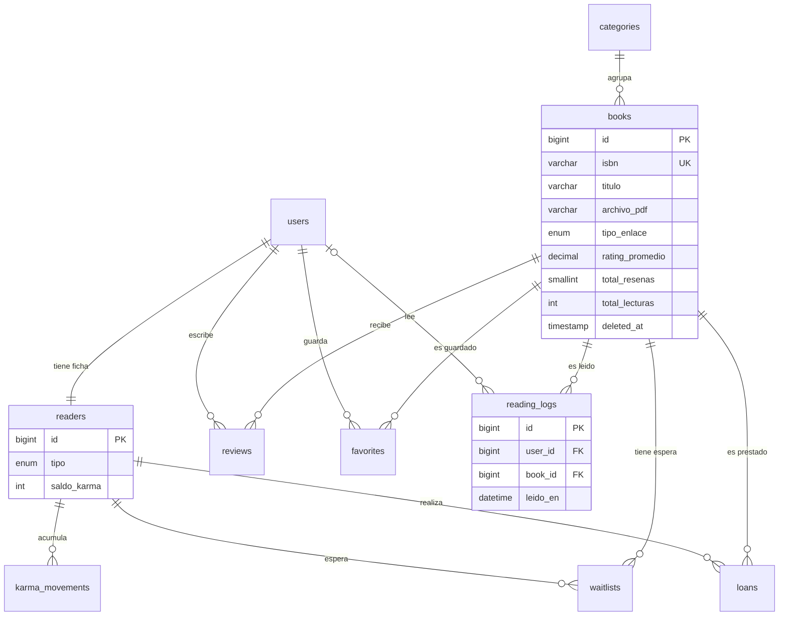

# Informe v2 · Optimización de `biblioteca_bd` (biblioteca 100% gratuita)

**Rol 1 · BD y Modelos** · Laravel + MariaDB/MySQL (XAMPP)

> **Este informe reemplaza al anterior.** El proyecto ya no tendrá planes, suscripciones ni cobros. Todo lo relacionado con dinero y niveles de acceso se elimina, y la base se optimiza para lo que sí es: un catálogo de libros con **lectura abierta/embebida**, gratis para todos.

---

## Tabla de contenido

1. [Qué cambia y por qué](#1-qué-cambia-y-por-qué)
2. [Qué se elimina y por qué](#2-qué-se-elimina-y-por-qué)
3. [Qué se conserva](#3-qué-se-conserva)
4. [Qué se agrega para optimizar](#4-qué-se-agrega-para-optimizar)
5. [Estructura final de la base](#5-estructura-final-de-la-base)
6. [Tabla comparativa: antes y después](#6-tabla-comparativa-antes-y-después)
7. [Script SQL completo](#7-script-sql-completo)
8. [Migración de Laravel](#8-migración-de-laravel)
9. [Cambios en los modelos](#9-cambios-en-los-modelos)
10. [Cambios en el seeder y la factory](#10-cambios-en-el-seeder-y-la-factory)
11. [Orden de aplicación](#11-orden-de-aplicación)
12. [Puntos a confirmar con el equipo](#12-puntos-a-confirmar-con-el-equipo)

---

## 1. Qué cambia y por qué

### 1.1 La idea central

La base original estaba diseñada como una **biblioteca con comercio**: vendía y alquilaba ejemplares, cobraba préstamos y tenía órdenes. En la propuesta anterior se había pensado añadir planes y suscripciones. Ahora el modelo de negocio es otro:

| Antes | Ahora |
|---|---|
| Venta y alquiler de libros | Todo es gratis |
| Pagos dentro de los préstamos | No hay pagos |
| (Propuesto) planes y suscripciones | No hay planes |
| Libros con precio | Libros sin precio |
| Acceso condicionado | Acceso libre a todo el catálogo |

### 1.2 Qué significa eso para la base de datos

Una base de datos refleja las reglas del negocio. Si el negocio ya no cobra, entonces **todo dato que exista solo para cobrar es peso muerto**:

- Ocupa espacio en disco.
- Hace más lentas las escrituras (cada índice y cada columna cuesta).
- Confunde a quien lee el esquema ("¿para qué sirve `estado_pago` si todo es gratis?").
- Obliga a mantener código y pruebas de algo que nadie usa.

Por eso el trabajo tiene dos partes: **quitar lo que sobra** y **agregar lo que sí hace falta** para que el catálogo de lectura sea rápido.

---

## 2. Qué se elimina y por qué

### 2.1 Tablas que se eliminan

| Tabla | Para qué existía | Por qué se elimina |
|---|---|---|
| `orders` | Registrar compras o alquileres | Ya no se vende ni alquila nada. Tiene 0 filas, así que no se pierde información. |
| `order_items` | Detalle de cada compra o alquiler | Depende de `orders`; sin órdenes no tiene sentido. También tiene 0 filas. |
| `plans`, `subscriptions`, `payments` | Planes, suscripciones y pagos (propuesta anterior) | Ya no existen en el proyecto. Si habías ejecutado el script anterior, el script nuevo las borra; si no, no hace nada. |

### 2.2 Columnas que se eliminan

**En `books`:**

| Columna | Motivo |
|---|---|
| `precio_venta` | No hay venta. |
| `precio_alquiler` | No hay alquiler. |
| `nivel_acceso` (si se creó con el script anterior) | Ya no hay niveles de plan. |

**En `loans`:**

| Columna | Motivo |
|---|---|
| `metodo_pago` | No hay pago. |
| `estado_pago` | No hay pago. |
| `codigo_operacion` | Era el código del pago. |
| `fecha_pago` | No hay pago. |
| `fecha_expiracion` | Era la expiración del pago pendiente. |

> **Detalle técnico importante:** en MariaDB, cuando eliminas una columna que forma parte de un índice, la columna sale del índice; y si el índice se quedaba solo con columnas eliminadas, el índice desaparece. Por eso el índice de "estado de pago y expiración" de `loans` se va solo junto con esas columnas. No tienes que borrarlo a mano.

### 2.3 Qué se elimina del código (modelos)

| Archivo | Acción |
|---|---|
| `Order.php` | Eliminar |
| `OrderItem.php` | Eliminar |
| `Loan.php` | Quitar de `$fillable` y `$casts` los campos de pago |
| `Book.php` | Quitar precios de `$fillable` |
| `Reader.php` | Quitar cualquier tipo o lógica de planes y precios |
| `User.php` | Quitar relaciones con órdenes (`hasMany(Order)`) si existen |

---

## 3. Qué se conserva

Todo esto sigue siendo válido en una biblioteca gratuita y no se toca:

| Tabla | Por qué se queda |
|---|---|
| `users` | Registro e inicio de sesión (para favoritos, reseñas, historial). |
| `readers` | Ficha del lector (con tipos estudiante, docente, público). |
| `categories` | Organiza el catálogo. |
| `books` | Es el corazón del proyecto. |
| `loans` | Controla préstamos (ver punto 12: depende de si son físicos o digitales). |
| `waitlists` | Lista de espera para libros agotados (solo útil si hay ejemplares físicos). |
| `reviews` | Calificaciones y comentarios de los lectores. |
| `favorites` | Libros guardados por usuario. |
| `karma_movements` | Puntos de participación: es gamificación, no comercio. |
| `complaints` | Libro de reclamaciones. |
| `api_tokens` | Acceso desde apps móviles. |
| Tablas de Laravel (`sessions`, `cache`, `jobs`, `migrations`, etc.) | Las usa el framework. |

---

## 4. Qué se agrega para optimizar

### 4.1 En `books`

| Columna nueva | Tipo | Para qué sirve |
|---|---|---|
| `archivo_pdf` | `VARCHAR(500)` | Enlace real de lectura abierta/embebida (tu tarea principal). Se pasa de `TEXT` a `VARCHAR(500)` para que pese menos y se pueda indexar. |
| `tipo_enlace` | `ENUM('pdf','embed','externo')` | Le dice a `Book.php` cómo mostrar el enlace: en visor PDF, en un iframe embebido o abriendo otra página. |
| `rating_promedio` | `DECIMAL(2,1)` | Calificación promedio guardada. Evita hacer `AVG()` sobre `reviews` en cada listado. |
| `total_resenas` | `SMALLINT UNSIGNED` | Número de reseñas guardado. Evita `COUNT()`. |
| `total_lecturas` | `INT UNSIGNED` | Cuántas veces se abrió el libro. Sirve para "los más leídos" sin recorrer el historial. |
| `deleted_at` | `TIMESTAMP NULL` | Borrado lógico: el libro se oculta pero no se pierde su historial. |

**¿Por qué guardar `rating_promedio` y `total_resenas`?**
Imagina el catálogo con 5,000 libros mostrando estrellas. Sin esta mejora, la base calcula el promedio de cada libro **cada vez que alguien abre el catálogo**. Con la mejora, el promedio ya está calculado y solo se actualiza cuando alguien escribe una reseña nueva (algo mucho menos frecuente que mirar el catálogo). Se cambia un poco de trabajo al escribir por mucho menos trabajo al leer.

### 4.2 En `readers`

| Cambio | Detalle |
|---|---|
| `tipo` → `ENUM('estudiante','docente','publico')` | Solo los tres tipos de biblioteca pública, como pide tu rol. Un `ENUM` pesa 1 byte y la base rechaza valores inválidos. |
| `saldo_karma INT` | Saldo guardado. Evita sumar todo `karma_movements` cada vez que se muestra el perfil. El historial se conserva en `karma_movements`. |

### 4.3 En `users`

| Cambio | Detalle |
|---|---|
| `deleted_at` | Borrado lógico. Hoy, al dar de baja un usuario, las restricciones pueden bloquear la operación porque tiene préstamos o reseñas. Con borrado lógico el usuario se desactiva sin romper nada. |

### 4.4 Tabla nueva: `reading_logs`

Una tabla pequeña que registra **cada vez que alguien abre un libro**.

```text
reading_logs
  id
  user_id    (puede ser NULL: permite lectura sin iniciar sesión)
  book_id
  leido_en
```

**¿Para qué, si ya no hay límites por plan?** Porque entrega información muy valiosa para una biblioteca:

- Libros **más leídos** (recomendaciones y portada).
- **Historial** del lector ("seguir leyendo", "leídos recientemente").
- Estadísticas para el informe final y para decidir qué libros agregar.

`user_id` admite `NULL` y la clave foránea usa `ON DELETE SET NULL`: si un usuario se borra, sus lecturas se conservan como estadística anónima en lugar de desaparecer.

### 4.5 Índices

| Índice | Tabla | Qué acelera |
|---|---|---|
| `(category_id, deleted_at)` | `books` | Listar libros de una categoría ignorando los borrados. |
| `(total_lecturas)` | `books` | Ordenar por "más leídos". |
| `(rating_promedio)` | `books` | Ordenar por "mejor calificados". |
| `(user_id, leido_en)` | `reading_logs` | Historial de un usuario. |
| `(book_id, leido_en)` | `reading_logs` | Lecturas de un libro por fecha. |

**Regla práctica:** cada índice acelera las lecturas pero encarece un poco las escrituras. Por eso solo se agregan los que responden a consultas reales del sitio. Revisa también los índices que ya tienes en `books` y quita los redundantes (por ejemplo, si existe un índice compuesto de stock y disponibilidad, uno solo de disponibilidad probablemente sobra). Verifica con `EXPLAIN`.

---

## 5. Estructura final de la base

### 5.1 Relaciones

```text
users (1) ---- (1) readers
categories (1) ----< (N) books
books / readers / users ----< loans
books / users ----< reviews
books / users ----< favorites
books / readers ----< waitlists
readers (1) ----< (N) karma_movements
users (1) ----< (N) reading_logs >---- (1) books   (user_id opcional)
users (1) ----< (N) api_tokens
users (1) ----< (N) complaints   (respondido_por_id)
```



### 5.2 Conteo de tablas

| | Antes | Después |
|---|---|---|
| Tablas de negocio | 13 | 11 (se van `orders` y `order_items`; entra `reading_logs`) |
| Columnas de pago | 5 en `loans` + 2 en `books` | 0 |
| Conceptos de planes | 0 (y 3 tablas en la propuesta anterior) | 0 |

---

## 6. Tabla comparativa: antes y después

| Aspecto | Base original | Base nueva (gratuita) | Ganancia |
|---|---|---|---|
| Modelo de negocio | Venta y alquiler | 100% gratuito | La base refleja la realidad |
| Tablas de comercio | `orders`, `order_items` | Eliminadas | Menos tablas, menos código |
| Precios en libros | `precio_venta`, `precio_alquiler` | Eliminados | Columnas útiles solamente |
| Pagos en préstamos | 5 columnas | Eliminadas | `loans` más liviana y clara |
| Enlace de lectura | `archivo_pdf` sin control | `VARCHAR(500)` + `tipo_enlace` | Lectura embebida bien resuelta |
| Calificación promedio | `AVG()` en cada consulta | Columna guardada | Catálogo más rápido |
| Saldo Karma | Suma del historial | Columna guardada | Perfil más rápido |
| Historial de lectura | No existe | `reading_logs` | Más leídos, historial, estadísticas |
| Tipo de lector | Mezclado | `ENUM` de 3 valores | Dato limpio y validado |
| Borrado | Físico | Lógico en `users` y `books` | No se pierde historial |

---

## 7. Script SQL completo

**Primero, copia de seguridad:**

```bash
mysqldump -u root -p biblioteca_bd > respaldo_biblioteca_bd.sql
```

> **Revisa antes de ejecutar:** los nombres de columnas (`calificacion` en `reviews`, `puntos` en `karma_movements`, los campos de pago de `loans`) se tomaron del informe del esquema. Compruébalos con `DESCRIBE nombre_tabla;` y ajusta lo que difiera. El script usa `IF EXISTS` / `IF NOT EXISTS` para poder ejecutarse más de una vez sin errores.

### 7.1 Limpiar lo que sobra de la propuesta anterior

Solo hace algo si ya habías ejecutado el script de planes; si no, no tiene efecto.

```sql
USE biblioteca_bd;

SET FOREIGN_KEY_CHECKS = 0;
DROP TABLE IF EXISTS payments;
DROP TABLE IF EXISTS subscriptions;
DROP TABLE IF EXISTS plans;
DROP TABLE IF EXISTS reading_logs;   -- se recrea más abajo con user_id opcional
SET FOREIGN_KEY_CHECKS = 1;

DROP INDEX IF EXISTS books_categoria_nivel_idx ON books;
DROP INDEX IF EXISTS books_nivel_idx ON books;
ALTER TABLE books DROP COLUMN IF EXISTS nivel_acceso;
```

### 7.2 Eliminar el comercio (ventas, alquileres y pagos)

Ejecuta este bloque **solo después de confirmar** con el equipo que nadie usa estas tablas ni columnas (ver punto 12).

```sql
-- Primero order_items (depende de orders y de loans), luego orders
SET FOREIGN_KEY_CHECKS = 0;
DROP TABLE IF EXISTS order_items;
DROP TABLE IF EXISTS orders;
SET FOREIGN_KEY_CHECKS = 1;

-- Precios en books
ALTER TABLE books
  DROP COLUMN IF EXISTS precio_venta,
  DROP COLUMN IF EXISTS precio_alquiler;

-- Campos de pago en loans (los índices que solo usaban estas columnas desaparecen solos)
ALTER TABLE loans
  DROP COLUMN IF EXISTS metodo_pago,
  DROP COLUMN IF EXISTS estado_pago,
  DROP COLUMN IF EXISTS codigo_operacion,
  DROP COLUMN IF EXISTS fecha_pago,
  DROP COLUMN IF EXISTS fecha_expiracion;
```

### 7.3 Optimizar `books`

```sql
ALTER TABLE books
  ADD COLUMN IF NOT EXISTS archivo_pdf VARCHAR(500) NULL,
  ADD COLUMN IF NOT EXISTS tipo_enlace ENUM('pdf','embed','externo') NOT NULL DEFAULT 'embed',
  ADD COLUMN IF NOT EXISTS rating_promedio DECIMAL(2,1) NOT NULL DEFAULT 0.0,
  ADD COLUMN IF NOT EXISTS total_resenas SMALLINT UNSIGNED NOT NULL DEFAULT 0,
  ADD COLUMN IF NOT EXISTS total_lecturas INT UNSIGNED NOT NULL DEFAULT 0,
  ADD COLUMN IF NOT EXISTS deleted_at TIMESTAMP NULL DEFAULT NULL;

-- Si archivo_pdf ya existía como TEXT, se reduce a VARCHAR(500)
ALTER TABLE books MODIFY COLUMN archivo_pdf VARCHAR(500) NULL;

CREATE INDEX IF NOT EXISTS books_categoria_deleted_idx ON books (category_id, deleted_at);
CREATE INDEX IF NOT EXISTS books_lecturas_idx ON books (total_lecturas);
CREATE INDEX IF NOT EXISTS books_rating_idx ON books (rating_promedio);

-- Cargar los contadores con los datos actuales
UPDATE books b
LEFT JOIN (
  SELECT book_id, ROUND(AVG(calificacion), 1) AS prom, COUNT(*) AS total
  FROM reviews
  GROUP BY book_id
) r ON r.book_id = b.id
SET b.rating_promedio = COALESCE(r.prom, 0),
    b.total_resenas   = COALESCE(r.total, 0);
```

### 7.4 Optimizar `readers` y `users`

```sql
-- Tipo de lector: solo estudiante, docente o publico
ALTER TABLE readers MODIFY COLUMN tipo VARCHAR(20) NOT NULL DEFAULT 'publico';
UPDATE readers SET tipo = 'publico' WHERE tipo NOT IN ('estudiante','docente','publico');
ALTER TABLE readers MODIFY COLUMN tipo ENUM('estudiante','docente','publico') NOT NULL DEFAULT 'publico';

-- Saldo Karma guardado
ALTER TABLE readers
  ADD COLUMN IF NOT EXISTS saldo_karma INT NOT NULL DEFAULT 0;

UPDATE readers r
LEFT JOIN (
  SELECT reader_id, SUM(puntos) AS saldo
  FROM karma_movements
  GROUP BY reader_id
) k ON k.reader_id = r.id
SET r.saldo_karma = COALESCE(k.saldo, 0);

-- Borrado lógico en users
ALTER TABLE users
  ADD COLUMN IF NOT EXISTS deleted_at TIMESTAMP NULL DEFAULT NULL;
```

### 7.5 Tabla nueva `reading_logs`

```sql
CREATE TABLE IF NOT EXISTS reading_logs (
  id BIGINT UNSIGNED NOT NULL AUTO_INCREMENT,
  user_id BIGINT UNSIGNED NULL,
  book_id BIGINT UNSIGNED NOT NULL,
  leido_en DATETIME NOT NULL DEFAULT CURRENT_TIMESTAMP,
  PRIMARY KEY (id),
  KEY reading_logs_user_leido_idx (user_id, leido_en),
  KEY reading_logs_book_leido_idx (book_id, leido_en),
  CONSTRAINT reading_logs_user_fk FOREIGN KEY (user_id) REFERENCES users (id) ON DELETE SET NULL,
  CONSTRAINT reading_logs_book_fk FOREIGN KEY (book_id) REFERENCES books (id) ON DELETE CASCADE
) ENGINE=InnoDB DEFAULT CHARSET=utf8mb4 COLLATE=utf8mb4_unicode_ci;
```

### 7.6 Verificación

```sql
-- Que ya no existan tablas de comercio ni de planes
SHOW TABLES;

-- Que loans y books no tengan columnas de pago/precio
DESCRIBE loans;
DESCRIBE books;

-- Libros más leídos
SELECT titulo, total_lecturas FROM books
WHERE deleted_at IS NULL
ORDER BY total_lecturas DESC LIMIT 10;

-- Libros mejor calificados
SELECT titulo, rating_promedio, total_resenas FROM books
WHERE deleted_at IS NULL AND total_resenas > 0
ORDER BY rating_promedio DESC LIMIT 10;

-- Historial reciente de un usuario
SELECT b.titulo, l.leido_en
FROM reading_logs l
JOIN books b ON b.id = l.book_id
WHERE l.user_id = 1
ORDER BY l.leido_en DESC LIMIT 10;

-- Confirmar que se usan los índices
EXPLAIN SELECT * FROM books
WHERE category_id = 1 AND deleted_at IS NULL;
```

---

## 8. Migración de Laravel

Como tu proyecto usa migraciones, lo ideal es que estos cambios queden como **una migración nueva** (no edites las anteriores si ya se subieron al repositorio). Crea el archivo con:

```bash
php artisan make:migration optimizar_biblioteca_gratuita
```

Y reemplaza su contenido por:

```php
<?php

use Illuminate\Database\Migrations\Migration;
use Illuminate\Database\Schema\Blueprint;
use Illuminate\Support\Facades\DB;
use Illuminate\Support\Facades\Schema;

return new class extends Migration
{
    public function up(): void
    {
        // 1. Eliminar el comercio (primero order_items por sus claves foráneas)
        Schema::dropIfExists('order_items');
        Schema::dropIfExists('orders');

        // 2. Books: quitar precios, agregar enlace de lectura y contadores
        Schema::table('books', function (Blueprint $table) {
            foreach (['precio_venta', 'precio_alquiler'] as $col) {
                if (Schema::hasColumn('books', $col)) {
                    $table->dropColumn($col);
                }
            }
        });

        Schema::table('books', function (Blueprint $table) {
            if (!Schema::hasColumn('books', 'archivo_pdf')) {
                $table->string('archivo_pdf', 500)->nullable();
            }
            $table->enum('tipo_enlace', ['pdf', 'embed', 'externo'])->default('embed');
            $table->decimal('rating_promedio', 2, 1)->default(0);
            $table->unsignedSmallInteger('total_resenas')->default(0);
            $table->unsignedInteger('total_lecturas')->default(0);
            $table->softDeletes();

            $table->index(['category_id', 'deleted_at'], 'books_categoria_deleted_idx');
            $table->index('total_lecturas', 'books_lecturas_idx');
            $table->index('rating_promedio', 'books_rating_idx');
        });

        // Si archivo_pdf existía como TEXT, se reduce a VARCHAR(500)
        DB::statement('ALTER TABLE books MODIFY archivo_pdf VARCHAR(500) NULL');

        // 3. Loans: quitar campos de pago
        Schema::table('loans', function (Blueprint $table) {
            foreach (['metodo_pago', 'estado_pago', 'codigo_operacion', 'fecha_pago', 'fecha_expiracion'] as $col) {
                if (Schema::hasColumn('loans', $col)) {
                    $table->dropColumn($col);
                }
            }
        });

        // 4. Readers: tipos de biblioteca pública y saldo Karma
        DB::statement("ALTER TABLE readers MODIFY tipo VARCHAR(20) NOT NULL DEFAULT 'publico'");
        DB::table('readers')
            ->whereNotIn('tipo', ['estudiante', 'docente', 'publico'])
            ->update(['tipo' => 'publico']);
        DB::statement("ALTER TABLE readers MODIFY tipo ENUM('estudiante','docente','publico') NOT NULL DEFAULT 'publico'");

        Schema::table('readers', function (Blueprint $table) {
            $table->integer('saldo_karma')->default(0);
        });

        // 5. Users: borrado lógico
        Schema::table('users', function (Blueprint $table) {
            $table->softDeletes();
        });

        // 6. Historial de lectura
        Schema::create('reading_logs', function (Blueprint $table) {
            $table->id();
            $table->foreignId('user_id')->nullable()->constrained()->nullOnDelete();
            $table->foreignId('book_id')->constrained()->cascadeOnDelete();
            $table->dateTime('leido_en')->useCurrent();

            $table->index(['user_id', 'leido_en']);
            $table->index(['book_id', 'leido_en']);
        });

        // 7. Cargar contadores con los datos actuales
        DB::statement('
            UPDATE books b
            LEFT JOIN (
                SELECT book_id, ROUND(AVG(calificacion), 1) AS prom, COUNT(*) AS total
                FROM reviews GROUP BY book_id
            ) r ON r.book_id = b.id
            SET b.rating_promedio = COALESCE(r.prom, 0),
                b.total_resenas   = COALESCE(r.total, 0)
        ');

        DB::statement('
            UPDATE readers r
            LEFT JOIN (
                SELECT reader_id, SUM(puntos) AS saldo FROM karma_movements GROUP BY reader_id
            ) k ON k.reader_id = r.id
            SET r.saldo_karma = COALESCE(k.saldo, 0)
        ');
    }

    public function down(): void
    {
        Schema::dropIfExists('reading_logs');

        Schema::table('users', function (Blueprint $table) {
            $table->dropSoftDeletes();
        });

        Schema::table('readers', function (Blueprint $table) {
            $table->dropColumn('saldo_karma');
        });

        Schema::table('books', function (Blueprint $table) {
            $table->dropIndex('books_categoria_deleted_idx');
            $table->dropIndex('books_lecturas_idx');
            $table->dropIndex('books_rating_idx');
            $table->dropColumn(['tipo_enlace', 'rating_promedio', 'total_resenas', 'total_lecturas']);
            $table->dropSoftDeletes();
        });

        // Las tablas orders/order_items y las columnas de pago no se restauran:
        // para volver atrás, usa la copia de seguridad.
    }
};
```

> **Usa el SQL o la migración, no ambos.** El SQL es útil para aplicar rápido en phpMyAdmin; la migración es lo que debe quedar en el repositorio para que tu equipo y el servidor la apliquen igual. Si ya ejecutaste el SQL en tu base local, marca la migración como ejecutada o restaura tu respaldo antes de correr `php artisan migrate`.

---

## 9. Cambios en los modelos

### 9.1 Resumen por archivo

| Archivo | Acción |
|---|---|
| `Order.php` | **Eliminar** |
| `OrderItem.php` | **Eliminar** |
| `Book.php` | Actualizar `$fillable`, agregar `SoftDeletes` y los métodos de enlace |
| `Reader.php` | Constante con los tipos válidos; quitar lógica de planes y precios |
| `Loan.php` | Quitar campos de pago de `$fillable` y `$casts` |
| `User.php` | Agregar `SoftDeletes` y relación `readingLogs()`; quitar `orders()` |
| `ReadingLog.php` | **Nuevo** modelo |
| `Category.php`, `Waitlist.php`, `Review.php`, `Favorite.php`, `Complaint.php`, `KarmaMovement.php`, `ApiToken.php` | Sin cambios (revisa que ninguno referencie `Order`) |

### 9.2 `Book.php` (enlaces de lectura embebibles)

Esta es tu tarea principal. La idea: la base guarda **un enlace tal como se copió** (por ejemplo, el de Google Drive o el de Archive.org), y el modelo lo convierte al formato que sí se puede **incrustar en un iframe**.

```php
<?php

namespace App\Models;

use Illuminate\Database\Eloquent\Factories\HasFactory;
use Illuminate\Database\Eloquent\Model;
use Illuminate\Database\Eloquent\SoftDeletes;

class Book extends Model
{
    use HasFactory, SoftDeletes;

    protected $fillable = [
        'isbn', 'titulo', 'autor', 'editorial', 'formato', 'sinopsis',
        'portada', 'ubicacion_fisica', 'stock', 'category_id',
        'archivo_pdf', 'tipo_enlace',
    ];

    public function category()
    {
        return $this->belongsTo(Category::class);
    }

    public function readingLogs()
    {
        return $this->hasMany(ReadingLog::class);
    }

    /**
     * Devuelve la URL lista para usar en un <iframe> o en un enlace,
     * o null si el libro no tiene enlace de lectura.
     */
    public function enlaceLectura(): ?string
    {
        $url = $this->archivo_pdf;

        if (!$url) {
            return null;
        }

        // Google Drive: /file/d/ID/view  ->  /file/d/ID/preview
        if (preg_match('#drive\.google\.com/file/d/([^/]+)#', $url, $m)) {
            return "https://drive.google.com/file/d/{$m[1]}/preview";
        }

        // Archive.org: /details/ID  ->  /embed/ID
        if (preg_match('#archive\.org/details/([^/?]+)#', $url, $m)) {
            return "https://archive.org/embed/{$m[1]}";
        }

        // Cualquier otro enlace (PDF directo, etc.) se devuelve tal cual
        return $url;
    }

    /**
     * ¿Se puede mostrar dentro de la página (iframe)?
     * Los enlaces de tipo "externo" deben abrirse en otra pestaña.
     */
    public function esEmbebible(): bool
    {
        return $this->archivo_pdf !== null && $this->tipo_enlace !== 'externo';
    }
}
```

> **Cuidado con los enlaces de Drive:** para que el iframe funcione, el archivo debe estar compartido como "Cualquier persona con el enlace". Si no, el visor mostrará un error aunque el código esté bien.

### 9.3 `Reader.php`

```php
class Reader extends Model
{
    public const TIPOS = ['estudiante', 'docente', 'publico'];

    protected $fillable = [
        // ...los campos que ya tenías (DNI/código, correo, etc.)...
        'tipo', 'user_id',
    ];

    // Elimina cualquier constante, método o atributo relacionado con planes o precios
}
```

### 9.4 `ReadingLog.php` (nuevo)

```php
<?php

namespace App\Models;

use Illuminate\Database\Eloquent\Model;

class ReadingLog extends Model
{
    public $timestamps = false;

    protected $fillable = ['user_id', 'book_id', 'leido_en'];

    protected $casts = ['leido_en' => 'datetime'];

    public function user()
    {
        return $this->belongsTo(User::class);
    }

    public function book()
    {
        return $this->belongsTo(Book::class);
    }
}
```

### 9.5 `User.php`

```php
use Illuminate\Database\Eloquent\SoftDeletes;

class User extends Authenticatable
{
    use SoftDeletes;   // junto a los traits que ya tengas

    public function readingLogs()
    {
        return $this->hasMany(ReadingLog::class);
    }

    // Elimina: public function orders() { ... }
}
```

### 9.6 Cómo registrar una lectura (para el controlador)

Cuando alguien abre un libro, se guarda el registro y se suma al contador **en una sola operación atómica** (para que no se pierdan lecturas si dos personas abren el libro a la vez):

```php
use Illuminate\Support\Facades\DB;

DB::transaction(function () use ($book) {
    ReadingLog::create([
        'user_id'  => auth()->id(),   // null si no inició sesión
        'book_id'  => $book->id,
        'leido_en' => now(),
    ]);

    $book->increment('total_lecturas');
});
```

Del mismo modo, al crear o borrar una reseña hay que recalcular `rating_promedio` y `total_resenas` de ese libro (puedes hacerlo en un observer de `Review`).

---

## 10. Cambios en el seeder y la factory

### 10.1 `DatabaseSeeder.php`

1. **Eliminar** todo lo que cree órdenes, ítems de orden, planes, precios o pagos.
2. **Cada libro del catálogo** debe llevar su enlace real de lectura:

```php
Book::create([
    'isbn'         => '978-...',
    'titulo'       => 'Título del libro',
    'autor'        => 'Autor',
    'editorial'    => 'Editorial',
    'formato'      => 'digital',
    'category_id'  => $categoria->id,
    'stock'        => 0,
    'archivo_pdf'  => 'https://archive.org/details/identificador-del-libro',
    'tipo_enlace'  => 'embed',
]);
```

3. Los lectores sembrados deben usar solo `estudiante`, `docente` o `publico`.
4. Si ya no se siembran órdenes ni pagos, quita también los `use` de `Order` y `OrderItem` al inicio del archivo.

> **Sobre los enlaces:** usa solo libros de **dominio público o de licencia abierta** (Archive.org, Project Gutenberg, bibliotecas digitales abiertas, repositorios institucionales). Incrustar PDFs con derechos de autor sin permiso puede traer problemas legales al proyecto.

### 10.2 `UserFactory.php`

Revisa que no genere campos de planes ni de pagos. Normalmente no necesita cambios más allá de eso; el nuevo `deleted_at` se deja en `NULL` por defecto.

### 10.3 `database/biblioteca_web.sql`

Al final, cuando todo funcione, **regenera el dump** con la base ya limpia, para que quien importe el archivo reciba la estructura nueva:

```bash
mysqldump -u root -p --routines biblioteca_bd > database/biblioteca_web.sql
```

---

## 11. Orden de aplicación

1. **Respaldo** de la base actual.
2. **Confirmar con el equipo** los puntos de la sección 12.
3. Ejecutar el SQL (7.1 a 7.5) **o** la migración (sección 8), no ambos.
4. Eliminar `Order.php` y `OrderItem.php`; actualizar los demás modelos y crear `ReadingLog.php`.
5. Actualizar `DatabaseSeeder.php` con los enlaces reales y sin planes/precios.
6. Probar con `php artisan migrate:fresh --seed` en una base de pruebas.
7. Verificar con las consultas de 7.6.
8. Regenerar `database/biblioteca_web.sql`.
9. Subir los cambios.

---

## 12. Puntos a confirmar con el equipo

Estas decisiones cambian detalles del diseño; conviene cerrarlas antes de aplicar la limpieza.

| Pregunta | Por qué importa |
|---|---|
| ¿Algún otro rol (API, pagos, vistas) usa `orders`, `order_items` o los campos de pago de `loans`? | Si alguien los usa, borrarlos rompería su parte. |
| ¿Los préstamos serán **físicos, digitales o ambos**? | Si todo es digital y de lectura abierta, `loans` y `waitlists` podrían simplificarse mucho o incluso eliminarse (no hay "agotados" en digital). Si hay ejemplares físicos, se mantienen `stock` y `ubicacion_fisica`. |
| ¿La lectura requiere **iniciar sesión** o es anónima? | Define si `reading_logs.user_id` queda siempre lleno o a veces vacío, y qué rutas necesitan autenticación. |
| ¿Se conserva el sistema **Karma**? | Si los puntos se ganaban o gastaban en compras, pierde sentido. Si es solo participación (reseñas, lecturas), se queda. |
| ¿Se conservan los **tokens API**? | Solo hacen falta si habrá app móvil. |
| El informe original menciona cuatro etapas de migraciones pero lista cinco. | Conviene revisar la tabla `migrations` antes de agregar la nueva. |
