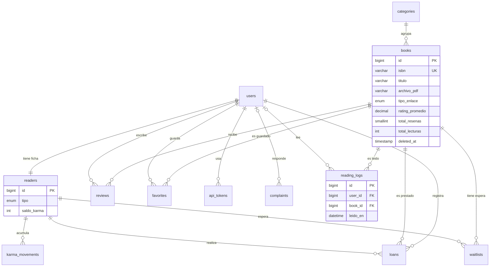

# Informe de optimización de `biblioteca_bd` · Versión 100% gratuita

**Rol 1 · BD y Modelos** · Laravel + MariaDB/MySQL (XAMPP)

> **Punto de partida:** este informe parte de la base de datos **inicial** (la original, sin ningún cambio aplicado). No hay planes, suscripciones ni scripts previos que revertir: el análisis y el script trabajan directamente sobre el esquema que describiste.

---

## Tabla de contenido

1. [Resumen](#1-resumen)
2. [Diagnóstico de la base inicial](#2-diagnóstico-de-la-base-inicial)
3. [Qué se elimina y por qué](#3-qué-se-elimina-y-por-qué)
4. [Qué se conserva](#4-qué-se-conserva)
5. [Qué se agrega para optimizar](#5-qué-se-agrega-para-optimizar)
6. [Estructura final](#6-estructura-final)
7. [Comparación: antes y después](#7-comparación-antes-y-después)
8. [Script SQL](#8-script-sql)
9. [Migración de Laravel](#9-migración-de-laravel)
10. [Cambios en modelos, seeder y factory](#10-cambios-en-modelos-seeder-y-factory)
11. [Orden de aplicación](#11-orden-de-aplicación)
12. [Puntos a confirmar con el equipo](#12-puntos-a-confirmar-con-el-equipo)

---

## 1. Resumen

La base inicial fue pensada para una biblioteca virtual **con comercio**: venta y alquiler de ejemplares, órdenes, precios y pagos dentro de los préstamos. El proyecto ahora será **100% gratuito**, así que todo lo que existe solo para cobrar pasa a ser peso muerto.

El trabajo se divide en tres partes:

| Parte | Qué se hace |
|---|---|
| **Quitar** | Tablas de comercio, precios, campos de pago e índices asociados |
| **Agregar** | Lo mínimo para que la lectura abierta funcione y el catálogo sea rápido |
| **Ordenar** | Tipos de lector, borrado lógico y revisión de índices redundantes |

**Una aclaración sobre "Suscripciones":** el resumen original menciona "suscripciones y puntos Karma", pero en la lista de tablas **no existe ninguna tabla de suscripciones**. Por tanto no hay nada que borrar en la base por ese concepto. Solo debes buscar y quitar cualquier referencia a suscripciones o planes en el **código** (modelos, seeder, factory, vistas) y en los **tipos de lector** de `readers`.

---

## 2. Diagnóstico de la base inicial

### 2.1 Fortalezas (se mantienen)

- **Integridad referencial sólida:** claves foráneas en todas las relaciones principales, con reglas `restrict`, `cascade` y `set null` coherentes.
- **Restricciones únicas útiles:** ISBN, correo, DNI/código del lector, nombre de categoría, código de reclamo, token API, una reseña y un favorito por usuario y libro.
- **Búsqueda de texto completo** por título y autor.
- **Buena separación** entre `users` (autenticación) y `readers` (ficha bibliotecaria).
- **Reclamos que sobreviven** al administrador que los respondió (`respondido_por_id` pasa a `NULL`).

### 2.2 Problemas detectados

| # | Problema | Consecuencia |
|---|---|---|
| 1 | `orders` y `order_items` (0 filas) sostienen un flujo de venta y alquiler que ya no existe. | Dos tablas, cuatro claves foráneas y varios índices que se mantienen sin ningún uso. |
| 2 | `books` guarda `precio de venta` y `precio de alquiler`. | Columnas sin sentido en una biblioteca gratuita. |
| 3 | `loans` mezcla dos cosas: el **préstamo** y el **cobro** (método y estado de pago, código de operación, fechas de pago y expiración). | La tabla es más ancha y confusa de lo necesario, y tiene un índice solo para pagos. |
| 4 | **Índices de comercio:** "estado de pago y expiración" en `loans` y `orders`, "órdenes por usuario y fecha", código único en `orders`. | Cada índice encarece las escrituras sin aportar nada. |
| 5 | **Posible redundancia de índices en `books`:** existe uno de "stock por categoría y disponibilidad" y otro de "disponibilidad independiente". | Si la disponibilidad ya es la segunda columna del compuesto, el índice suelto puede sobrar. Hay que verificarlo. |
| 6 | **No hay un lugar claro para el enlace de lectura** con control de longitud y tipo. | Dificulta tu tarea de enlaces embebibles. |
| 7 | **Promedios y saldos calculados al vuelo:** `AVG()` sobre reseñas y suma de `karma_movements`. | Cada listado del catálogo y cada perfil repiten cálculos. |
| 8 | **Tipos de lector sin controlar** (tu rol pide dejar solo estudiante, docente y público). | Valores libres permiten datos inconsistentes. |
| 9 | **Borrado solo físico.** | Dar de baja un usuario o libro choca con las restricciones (`restrict`) porque tienen préstamos o reseñas. |
| 10 | **Reglas de borrado poco claras:** el informe dice "`ON DELETE CASCADE` o configuración de Laravel según la tabla". | Conviene confirmar con `SHOW CREATE TABLE` qué hace realmente cada clave foránea. |
| 11 | **`karma_movements` guarda una referencia al elemento que originó el movimiento.** | Si algún movimiento apunta a una orden, quedaría huérfano al borrar `orders` (ver punto 12). |
| 12 | El informe dice "cuatro etapas" de migraciones pero lista cinco. | Hay que revisar el historial real antes de agregar una migración. |

---

## 3. Qué se elimina y por qué

### 3.1 Tablas

| Tabla | Para qué existía | Por qué se elimina |
|---|---|---|
| `order_items` | Detalle (venta o alquiler, cantidad, duración, precio unitario, subtotal) de cada orden | Sin órdenes no tiene sentido. 0 filas: no se pierde información. |
| `orders` | Compras y alquileres de un usuario | Ya no se vende ni alquila. 0 filas. |

**Orden de borrado:** primero `order_items` y luego `orders`, porque `order_items` depende de ambas (y de `loans` y `books`).

### 3.2 Columnas de `books`

| Columna | Motivo |
|---|---|
| Precio de venta | No hay venta |
| Precio de alquiler | No hay alquiler |

### 3.3 Columnas de `loans`

| Columna | Motivo |
|---|---|
| Método de pago | No hay cobro |
| Estado de pago | No hay cobro |
| Código de operación | Era el código del pago |
| Fecha de pago | No hay cobro |
| Fecha de expiración | Era la expiración del pago pendiente |

> **Detalle técnico:** en MariaDB, al eliminar una columna que forma parte de un índice, la columna sale del índice; y si el índice se queda sin columnas, desaparece. Por eso el índice de "estado de pago y expiración" de `loans` se elimina solo junto con esas columnas. Igual, verifícalo después con `SHOW INDEX FROM loans;`.

### 3.4 Relaciones y reglas que desaparecen

- Claves foráneas: `orders.user_id`, `orders.reader_id`, `order_items.order_id`, `order_items.book_id`, `order_items.loan_id`.
- Restricción única del código de `orders`.
- Índices: órdenes por usuario y fecha, estado de pago y expiración (en `orders` y `loans`).
- Relaciones del diagrama: `readers -> orders` y `users -> orders`.
- El efecto "al eliminar un préstamo, `order_items.loan_id` queda nulo" ya no hace falta.

### 3.5 Código que se elimina o se limpia

| Archivo | Acción |
|---|---|
| `Order.php` | **Eliminar** |
| `OrderItem.php` | **Eliminar** |
| `Loan.php` | Quitar los campos de pago de `$fillable` y `$casts` |
| `Book.php` | Quitar los precios de `$fillable` |
| `Reader.php` | Quitar cualquier lógica de planes, suscripciones o precios; dejar solo los tres tipos |
| `User.php` y otros | Quitar relaciones con órdenes (`orders()`) y cualquier referencia a suscripciones |
| `DatabaseSeeder.php` | Quitar siembra de órdenes, ítems, precios y datos de planes |
| `UserFactory.php` | Revisar que no genere campos de planes o precios |

---

## 4. Qué se conserva

| Tabla | Por qué se queda |
|---|---|
| `users` | Registro e inicio de sesión (favoritos, reseñas, historial) |
| `readers` | Ficha del lector, con tipos estudiante, docente y público |
| `categories` | Organiza el catálogo |
| `books` | Es el corazón del proyecto |
| `loans` | Controla préstamos (ver punto 12: depende de si son físicos o digitales) |
| `waitlists` | Lista de espera para libros agotados (solo útil si hay ejemplares físicos) |
| `reviews` | Calificaciones y comentarios, con moderación |
| `favorites` | Libros guardados por usuario |
| `karma_movements` | Puntos de participación: es gamificación, no comercio |
| `complaints` | Libro de reclamaciones |
| `api_tokens` | Acceso desde apps móviles |
| `sessions`, `cache`, `cache_locks`, `jobs`, `failed_jobs`, `job_batches`, `migrations`, `password_reset_tokens` | Las usa Laravel |

---

## 5. Qué se agrega para optimizar

### 5.1 En `books`

| Columna | Tipo | Para qué sirve |
|---|---|---|
| `archivo_pdf` | `VARCHAR(500)` | Enlace real de lectura abierta/embebida (tu tarea principal). Se usa `VARCHAR(500)` en vez de `TEXT` para que pese menos y se pueda indexar. |
| `tipo_enlace` | `ENUM('pdf','embed','externo')` | Le dice a `Book.php` cómo mostrar el enlace: visor PDF, iframe o pestaña nueva. |
| `rating_promedio` | `DECIMAL(2,1)` | Promedio guardado. Evita `AVG()` sobre `reviews` en cada listado. |
| `total_resenas` | `SMALLINT UNSIGNED` | Cantidad de reseñas guardada. Evita `COUNT()`. |
| `total_lecturas` | `INT UNSIGNED` | Veces que se abrió el libro. Sirve para "más leídos". |
| `deleted_at` | `TIMESTAMP NULL` | Borrado lógico: el libro se oculta sin perder historial. |

**¿Por qué guardar el promedio?** Imagina un catálogo de 5,000 libros mostrando estrellas. Sin la mejora, la base calcula el promedio de cada libro **cada vez que alguien abre el catálogo**. Con la mejora, el valor ya está guardado y solo se recalcula cuando alguien escribe una reseña, algo mucho menos frecuente que mirar el catálogo. Se gasta un poco más al escribir para gastar mucho menos al leer.

### 5.2 En `readers`

| Cambio | Detalle |
|---|---|
| `tipo` como `ENUM('estudiante','docente','publico')` | Solo los tres tipos de biblioteca pública. La base rechaza valores inválidos y el `ENUM` pesa 1 byte. |
| `saldo_karma INT` | Saldo guardado, sin sumar todo `karma_movements` en cada perfil. El historial se conserva. |

### 5.3 En `users`

| Cambio | Detalle |
|---|---|
| `deleted_at` | Borrado lógico. Hoy dar de baja a un usuario con préstamos o reseñas puede ser bloqueado por las restricciones. Con borrado lógico se desactiva sin romper nada. |

> **Efecto a tener en cuenta:** un usuario o libro borrado lógicamente **sigue ocupando su correo o su ISBN único**. Si quieres reutilizarlos, habría que liberarlos antes (por ejemplo, modificándolos al borrar). Si no, no es un problema.

### 5.4 Índices nuevos

| Índice | Tabla | Qué acelera |
|---|---|---|
| `(category_id, deleted_at)` | `books` | Listar los libros de una categoría ignorando los borrados |
| `(total_lecturas)` | `books` | "Más leídos" |
| `(rating_promedio)` | `books` | "Mejor calificados" |

### 5.4.1 Índices a revisar (los de la base inicial)

Cada índice acelera lecturas pero encarece escrituras, así que no conviene acumularlos. Ejecuta:

```sql
SHOW INDEX FROM books;
```

Si encuentras un índice de una sola columna (por ejemplo, disponibilidad) que ya es la **primera columna** de otro índice compuesto, el simple sobra y puedes borrarlo con `DROP INDEX nombre ON books;`. Si la disponibilidad es la **segunda** columna del compuesto, ese compuesto no sirve para buscar solo por disponibilidad, y entonces el índice suelto sí tiene razón de existir. Confirma con `EXPLAIN` antes de borrar nada.

### 5.5 Módulo opcional: historial de lectura (`reading_logs`)

Una tabla pequeña que registra cada vez que alguien abre un libro:

```text
reading_logs
  id
  user_id    (puede ser NULL: permite lectura sin iniciar sesión)
  book_id
  leido_en
```

No es necesaria para que la base sea gratuita, pero aporta: libros más leídos, "seguir leyendo" y estadísticas para el informe final. `user_id` admite `NULL` y usa `ON DELETE SET NULL`: si un usuario se borra, sus lecturas se conservan como estadística anónima. **Si tu equipo no la quiere, omite ese bloque del script** (y quita también `total_lecturas` de `books`).

---

## 6. Estructura final

### 6.1 Relaciones

```text
users (1) ---- (1) readers
categories (1) ----< (N) books
books / readers / users ----< loans
books / users ----< reviews        (moderado_por_id -> users)
books / users ----< favorites
books / readers ----< waitlists
readers (1) ----< (N) karma_movements
users (1) ----< (N) api_tokens
users (1) ----< (N) complaints     (respondido_por_id)
users (0..1) ----< (N) reading_logs >---- (1) books      [opcional]
```



### 6.2 Flujo funcional resultante

```text
Usuario
  ├── tiene una ficha de lector
  │     ├── realiza préstamos
  │     ├── recibe puntos Karma
  │     └── puede solicitar lista de espera
  ├── escribe reseñas
  ├── guarda favoritos
  ├── lee libros (historial opcional)
  └── usa tokens API

Categoría
  └── agrupa libros
       ├── se leen gratis con enlace embebido (archivo_pdf)
       ├── se prestan
       ├── reciben reseñas y favoritos
       └── generan lista de espera si están agotados
```

Desaparece por completo la rama de **Orden → order_items → venta o alquiler**.

### 6.3 Conteo

| | Antes | Después |
|---|---|---|
| Tablas de negocio | 13 | 11 (12 con `reading_logs`) |
| Claves foráneas de comercio | 5 | 0 |
| Campos de pago en `loans` | 5 | 0 |
| Precios en `books` | 2 | 0 |

---

## 7. Comparación: antes y después

| Aspecto | Base inicial | Base nueva (gratuita) | Ganancia |
|---|---|---|---|
| Modelo de negocio | Venta, alquiler y cobros | 100% gratuito | La base refleja la realidad |
| Tablas de comercio | `orders`, `order_items` | Eliminadas | Menos tablas y menos código |
| Precios en libros | Venta y alquiler | Eliminados | Solo columnas útiles |
| Pagos en préstamos | 5 columnas | Eliminadas | `loans` más liviana y clara |
| Índices de pago | En `loans` y `orders` | Eliminados | Escrituras más rápidas |
| Enlace de lectura | Sin control definido | `VARCHAR(500)` + `tipo_enlace` | Lectura embebida bien resuelta |
| Calificación promedio | `AVG()` en cada consulta | Columna guardada | Catálogo más rápido |
| Saldo Karma | Suma del historial | Columna guardada | Perfil más rápido |
| Tipo de lector | Sin validar | `ENUM` de 3 valores | Dato limpio |
| Borrado | Solo físico | Lógico en `users` y `books` | Se conserva el historial |
| Índices de `books` | Posibles redundancias | Revisados con `EXPLAIN` | Menos costo de escritura |

---

## 8. Script SQL

**Primero, copia de seguridad:**

```bash
mysqldump -u root -p biblioteca_bd > respaldo_biblioteca_bd.sql
```

> **Revisa antes de ejecutar.** Los nombres de columnas se tomaron de tu informe y no pude verificarlos contra la base real. Comprueba con `DESCRIBE nombre_tabla;` los de `loans` (campos de pago), `books` (precios), `readers` (tipo de lector), `reviews` (calificación) y `karma_movements` (puntos). Donde difieran, ajusta el script. Usa `IF EXISTS` / `IF NOT EXISTS`, así que puedes repetirlo sin errores.

### 8.1 Eliminar el comercio

Ejecuta este bloque **solo después de confirmar** que nadie más usa estas tablas ni columnas (ver punto 12).

```sql
USE biblioteca_bd;

-- Primero order_items (depende de orders, books y loans), luego orders
SET FOREIGN_KEY_CHECKS = 0;
DROP TABLE IF EXISTS order_items;
DROP TABLE IF EXISTS orders;
SET FOREIGN_KEY_CHECKS = 1;

-- Precios en books
ALTER TABLE books
  DROP COLUMN IF EXISTS precio_venta,
  DROP COLUMN IF EXISTS precio_alquiler;

-- Campos de pago en loans (los índices que solo usaban estas columnas desaparecen solos)
ALTER TABLE loans
  DROP COLUMN IF EXISTS metodo_pago,
  DROP COLUMN IF EXISTS estado_pago,
  DROP COLUMN IF EXISTS codigo_operacion,
  DROP COLUMN IF EXISTS fecha_pago,
  DROP COLUMN IF EXISTS fecha_expiracion;
```

### 8.2 Optimizar `books`

```sql
ALTER TABLE books
  ADD COLUMN IF NOT EXISTS archivo_pdf VARCHAR(500) NULL,
  ADD COLUMN IF NOT EXISTS tipo_enlace ENUM('pdf','embed','externo') NOT NULL DEFAULT 'embed',
  ADD COLUMN IF NOT EXISTS rating_promedio DECIMAL(2,1) NOT NULL DEFAULT 0.0,
  ADD COLUMN IF NOT EXISTS total_resenas SMALLINT UNSIGNED NOT NULL DEFAULT 0,
  ADD COLUMN IF NOT EXISTS total_lecturas INT UNSIGNED NOT NULL DEFAULT 0,
  ADD COLUMN IF NOT EXISTS deleted_at TIMESTAMP NULL DEFAULT NULL;

-- Si archivo_pdf ya existía como TEXT, se reduce a VARCHAR(500)
ALTER TABLE books MODIFY COLUMN archivo_pdf VARCHAR(500) NULL;

CREATE INDEX IF NOT EXISTS books_categoria_deleted_idx ON books (category_id, deleted_at);
CREATE INDEX IF NOT EXISTS books_lecturas_idx ON books (total_lecturas);
CREATE INDEX IF NOT EXISTS books_rating_idx ON books (rating_promedio);

-- Cargar los contadores con los datos actuales
UPDATE books b
LEFT JOIN (
  SELECT book_id, ROUND(AVG(calificacion), 1) AS prom, COUNT(*) AS total
  FROM reviews
  GROUP BY book_id
) r ON r.book_id = b.id
SET b.rating_promedio = COALESCE(r.prom, 0),
    b.total_resenas   = COALESCE(r.total, 0);
```

### 8.3 Optimizar `readers` y `users`

```sql
-- Tipo de lector: solo estudiante, docente o publico
-- (si la columna no existe se crea; si se llama distinto, ajusta el nombre)
ALTER TABLE readers ADD COLUMN IF NOT EXISTS tipo VARCHAR(20) NOT NULL DEFAULT 'publico';
ALTER TABLE readers MODIFY COLUMN tipo VARCHAR(20) NOT NULL DEFAULT 'publico';
UPDATE readers SET tipo = 'publico' WHERE tipo NOT IN ('estudiante','docente','publico');
ALTER TABLE readers MODIFY COLUMN tipo ENUM('estudiante','docente','publico') NOT NULL DEFAULT 'publico';

-- Saldo Karma guardado
ALTER TABLE readers
  ADD COLUMN IF NOT EXISTS saldo_karma INT NOT NULL DEFAULT 0;

UPDATE readers r
LEFT JOIN (
  SELECT reader_id, SUM(puntos) AS saldo
  FROM karma_movements
  GROUP BY reader_id
) k ON k.reader_id = r.id
SET r.saldo_karma = COALESCE(k.saldo, 0);

-- Borrado lógico en users
ALTER TABLE users
  ADD COLUMN IF NOT EXISTS deleted_at TIMESTAMP NULL DEFAULT NULL;
```

### 8.4 Módulo opcional: `reading_logs`

Omite este bloque si tu equipo no quiere historial de lectura.

```sql
CREATE TABLE IF NOT EXISTS reading_logs (
  id BIGINT UNSIGNED NOT NULL AUTO_INCREMENT,
  user_id BIGINT UNSIGNED NULL,
  book_id BIGINT UNSIGNED NOT NULL,
  leido_en DATETIME NOT NULL DEFAULT CURRENT_TIMESTAMP,
  PRIMARY KEY (id),
  KEY reading_logs_user_leido_idx (user_id, leido_en),
  KEY reading_logs_book_leido_idx (book_id, leido_en),
  CONSTRAINT reading_logs_user_fk FOREIGN KEY (user_id) REFERENCES users (id) ON DELETE SET NULL,
  CONSTRAINT reading_logs_book_fk FOREIGN KEY (book_id) REFERENCES books (id) ON DELETE CASCADE
) ENGINE=InnoDB DEFAULT CHARSET=utf8mb4 COLLATE=utf8mb4_unicode_ci;
```

### 8.5 Verificación

```sql
-- Ya no deben existir orders ni order_items
SHOW TABLES;

-- loans y books sin campos de pago ni precios
DESCRIBE loans;
DESCRIBE books;

-- Índices resultantes (busca los redundantes)
SHOW INDEX FROM books;
SHOW INDEX FROM loans;

-- Tipos de lector válidos
SELECT tipo, COUNT(*) FROM readers GROUP BY tipo;

-- Libros mejor calificados
SELECT titulo, rating_promedio, total_resenas FROM books
WHERE deleted_at IS NULL AND total_resenas > 0
ORDER BY rating_promedio DESC LIMIT 10;

-- Confirmar que se usa el índice nuevo
EXPLAIN SELECT * FROM books
WHERE category_id = 1 AND deleted_at IS NULL;
```

---

## 9. Migración de Laravel

Como tu proyecto usa migraciones, lo ideal es que el cambio quede como **una migración nueva**, sin editar las anteriores. Hay dos caminos:

| Camino | Cuándo usarlo |
|---|---|
| **A. Migración nueva (recomendado)** | Si el proyecto ya está en el repositorio y otras personas tienen su base creada con las migraciones actuales. |
| **B. Editar las migraciones originales y `migrate:fresh --seed`** | Solo si nadie más ha migrado todavía y no importa perder los datos de prueba (que son pocos). |

Camino A:

```bash
php artisan make:migration optimizar_biblioteca_gratuita
```

```php
<?php

use Illuminate\Database\Migrations\Migration;
use Illuminate\Database\Schema\Blueprint;
use Illuminate\Support\Facades\DB;
use Illuminate\Support\Facades\Schema;

return new class extends Migration
{
    public function up(): void
    {
        // 1. Eliminar el comercio (primero order_items por sus claves foráneas)
        Schema::dropIfExists('order_items');
        Schema::dropIfExists('orders');

        // 2. Books: quitar precios
        Schema::table('books', function (Blueprint $table) {
            foreach (['precio_venta', 'precio_alquiler'] as $col) {
                if (Schema::hasColumn('books', $col)) {
                    $table->dropColumn($col);
                }
            }
        });

        // 3. Books: enlace de lectura, contadores y borrado lógico
        Schema::table('books', function (Blueprint $table) {
            if (!Schema::hasColumn('books', 'archivo_pdf')) {
                $table->string('archivo_pdf', 500)->nullable();
            }
            $table->enum('tipo_enlace', ['pdf', 'embed', 'externo'])->default('embed');
            $table->decimal('rating_promedio', 2, 1)->default(0);
            $table->unsignedSmallInteger('total_resenas')->default(0);
            $table->unsignedInteger('total_lecturas')->default(0);
            $table->softDeletes();

            $table->index(['category_id', 'deleted_at'], 'books_categoria_deleted_idx');
            $table->index('total_lecturas', 'books_lecturas_idx');
            $table->index('rating_promedio', 'books_rating_idx');
        });

        // Si archivo_pdf existía como TEXT, se reduce a VARCHAR(500)
        DB::statement('ALTER TABLE books MODIFY archivo_pdf VARCHAR(500) NULL');

        // 4. Loans: quitar campos de pago
        Schema::table('loans', function (Blueprint $table) {
            foreach (['metodo_pago', 'estado_pago', 'codigo_operacion', 'fecha_pago', 'fecha_expiracion'] as $col) {
                if (Schema::hasColumn('loans', $col)) {
                    $table->dropColumn($col);
                }
            }
        });

        // 5. Readers: tipos de biblioteca pública y saldo Karma
        if (!Schema::hasColumn('readers', 'tipo')) {
            Schema::table('readers', function (Blueprint $table) {
                $table->string('tipo', 20)->default('publico');
            });
        }
        DB::statement("ALTER TABLE readers MODIFY tipo VARCHAR(20) NOT NULL DEFAULT 'publico'");
        DB::table('readers')
            ->whereNotIn('tipo', ['estudiante', 'docente', 'publico'])
            ->update(['tipo' => 'publico']);
        DB::statement("ALTER TABLE readers MODIFY tipo ENUM('estudiante','docente','publico') NOT NULL DEFAULT 'publico'");

        Schema::table('readers', function (Blueprint $table) {
            $table->integer('saldo_karma')->default(0);
        });

        // 6. Users: borrado lógico
        Schema::table('users', function (Blueprint $table) {
            $table->softDeletes();
        });

        // 7. Historial de lectura (OPCIONAL: elimina este bloque si no lo quieren)
        Schema::create('reading_logs', function (Blueprint $table) {
            $table->id();
            $table->foreignId('user_id')->nullable()->constrained()->nullOnDelete();
            $table->foreignId('book_id')->constrained()->cascadeOnDelete();
            $table->dateTime('leido_en')->useCurrent();

            $table->index(['user_id', 'leido_en']);
            $table->index(['book_id', 'leido_en']);
        });

        // 8. Cargar contadores con los datos actuales
        DB::statement('
            UPDATE books b
            LEFT JOIN (
                SELECT book_id, ROUND(AVG(calificacion), 1) AS prom, COUNT(*) AS total
                FROM reviews GROUP BY book_id
            ) r ON r.book_id = b.id
            SET b.rating_promedio = COALESCE(r.prom, 0),
                b.total_resenas   = COALESCE(r.total, 0)
        ');

        DB::statement('
            UPDATE readers r
            LEFT JOIN (
                SELECT reader_id, SUM(puntos) AS saldo FROM karma_movements GROUP BY reader_id
            ) k ON k.reader_id = r.id
            SET r.saldo_karma = COALESCE(k.saldo, 0)
        ');
    }

    public function down(): void
    {
        Schema::dropIfExists('reading_logs');

        Schema::table('users', function (Blueprint $table) {
            $table->dropSoftDeletes();
        });

        Schema::table('readers', function (Blueprint $table) {
            $table->dropColumn('saldo_karma');
        });

        Schema::table('books', function (Blueprint $table) {
            $table->dropIndex('books_categoria_deleted_idx');
            $table->dropIndex('books_lecturas_idx');
            $table->dropIndex('books_rating_idx');
            $table->dropColumn(['tipo_enlace', 'rating_promedio', 'total_resenas', 'total_lecturas']);
            $table->dropSoftDeletes();
        });

        // Las tablas orders/order_items y las columnas de pago no se restauran:
        // para volver atrás, usa la copia de seguridad.
    }
};
```

> **Usa el SQL o la migración, no ambos.** El SQL sirve para aplicar rápido en phpMyAdmin; la migración es lo que debe quedar en el repositorio. Si ya ejecutaste el SQL en tu base local, restaura tu respaldo antes de correr `php artisan migrate`.

> **No borres las migraciones antiguas** que crearon `orders`, `order_items` y los campos de pago: forman parte del historial y la migración nueva las deshace de forma ordenada.

---

## 10. Cambios en modelos, seeder y factory

### 10.1 Resumen por archivo

| Archivo | Acción |
|---|---|
| `Order.php` | **Eliminar** |
| `OrderItem.php` | **Eliminar** |
| `Book.php` | Actualizar `$fillable`, agregar `SoftDeletes` y los métodos de enlace |
| `Reader.php` | Constante con los tipos válidos; quitar lógica de planes y precios |
| `Loan.php` | Quitar campos de pago de `$fillable` y `$casts` |
| `User.php` | `SoftDeletes`; quitar `orders()` y referencias a suscripciones |
| `ReadingLog.php` | **Nuevo** (solo si usas el módulo opcional) |
| `Category.php`, `Waitlist.php`, `Review.php`, `Favorite.php`, `Complaint.php`, `KarmaMovement.php`, `ApiToken.php` | Sin cambios (revisa que ninguno referencie `Order`) |

### 10.2 `Book.php` (enlaces de lectura embebibles)

Esta es tu tarea principal. La base guarda **el enlace tal como se copió** (por ejemplo, el de Google Drive o el de Archive.org) y el modelo lo convierte al formato que sí se puede **incrustar en un iframe**.

```php
<?php

namespace App\Models;

use Illuminate\Database\Eloquent\Factories\HasFactory;
use Illuminate\Database\Eloquent\Model;
use Illuminate\Database\Eloquent\SoftDeletes;

class Book extends Model
{
    use HasFactory, SoftDeletes;

    protected $fillable = [
        'isbn', 'titulo', 'autor', 'editorial', 'formato', 'sinopsis',
        'portada', 'ubicacion_fisica', 'stock', 'category_id',
        'archivo_pdf', 'tipo_enlace',
    ];

    public function category()
    {
        return $this->belongsTo(Category::class);
    }

    /**
     * URL lista para un <iframe> o un enlace, o null si no hay enlace de lectura.
     */
    public function enlaceLectura(): ?string
    {
        $url = $this->archivo_pdf;

        if (!$url) {
            return null;
        }

        // Google Drive: /file/d/ID/view  ->  /file/d/ID/preview
        if (preg_match('#drive\.google\.com/file/d/([^/]+)#', $url, $m)) {
            return "https://drive.google.com/file/d/{$m[1]}/preview";
        }

        // Archive.org: /details/ID  ->  /embed/ID
        if (preg_match('#archive\.org/details/([^/?]+)#', $url, $m)) {
            return "https://archive.org/embed/{$m[1]}";
        }

        // Cualquier otro enlace (PDF directo, etc.) se devuelve tal cual
        return $url;
    }

    /**
     * ¿Se puede mostrar dentro de la página (iframe)?
     * Los enlaces de tipo "externo" deben abrirse en otra pestaña.
     */
    public function esEmbebible(): bool
    {
        return $this->archivo_pdf !== null && $this->tipo_enlace !== 'externo';
    }
}
```

> **Enlaces de Drive:** para que el iframe funcione, el archivo debe estar compartido como "Cualquier persona con el enlace". Si no, el visor mostrará un error aunque el código esté bien.

### 10.3 `Reader.php`

```php
class Reader extends Model
{
    public const TIPOS = ['estudiante', 'docente', 'publico'];

    protected $fillable = [
        // ...los campos que ya tenías (DNI/código, correo, etc.)...
        'tipo', 'user_id',
    ];

    // Elimina cualquier constante, método o atributo relacionado con planes, suscripciones o precios
}
```

### 10.4 `User.php`

```php
use Illuminate\Database\Eloquent\SoftDeletes;

class User extends Authenticatable
{
    use SoftDeletes;   // junto a los traits que ya tengas

    // Elimina: public function orders() { ... }
}
```

### 10.5 `ReadingLog.php` (módulo opcional)

```php
<?php

namespace App\Models;

use Illuminate\Database\Eloquent\Model;

class ReadingLog extends Model
{
    public $timestamps = false;

    protected $fillable = ['user_id', 'book_id', 'leido_en'];

    protected $casts = ['leido_en' => 'datetime'];

    public function user()
    {
        return $this->belongsTo(User::class);
    }

    public function book()
    {
        return $this->belongsTo(Book::class);
    }
}
```

Para registrar una lectura (en el controlador), todo en una sola operación para no perder conteos si dos personas abren el libro a la vez:

```php
use Illuminate\Support\Facades\DB;

DB::transaction(function () use ($book) {
    ReadingLog::create([
        'user_id'  => auth()->id(),   // null si no inició sesión
        'book_id'  => $book->id,
        'leido_en' => now(),
    ]);

    $book->increment('total_lecturas');
});
```

Y al crear o borrar una reseña, recalcula `rating_promedio` y `total_resenas` del libro (puedes hacerlo en un observer de `Review`).

### 10.6 `DatabaseSeeder.php`

1. **Elimina** todo lo que cree órdenes, ítems de orden, precios o datos de planes/suscripciones, y los `use` de `Order` y `OrderItem`.
2. **Cada libro del catálogo** debe llevar su enlace real de lectura:

```php
Book::create([
    'isbn'         => '978-...',
    'titulo'       => 'Título del libro',
    'autor'        => 'Autor',
    'editorial'    => 'Editorial',
    'formato'      => 'digital',
    'category_id'  => $categoria->id,
    'stock'        => 0,
    'archivo_pdf'  => 'https://archive.org/details/identificador-del-libro',
    'tipo_enlace'  => 'embed',
]);
```

3. Los lectores sembrados deben usar solo `estudiante`, `docente` o `publico`.

> **Sobre los enlaces:** usa solo libros de **dominio público o licencia abierta** (Archive.org, Project Gutenberg, bibliotecas digitales abiertas, repositorios institucionales). Incrustar PDFs con derechos de autor sin permiso puede traer problemas legales al proyecto.

### 10.7 `UserFactory.php` y `biblioteca_web.sql`

- **`UserFactory.php`:** revisa que no genere campos de planes ni de pagos. El nuevo `deleted_at` queda en `NULL` por defecto.
- **`database/biblioteca_web.sql`:** cuando todo funcione, regenera el dump con la base ya limpia:

```bash
mysqldump -u root -p --routines biblioteca_bd > database/biblioteca_web.sql
```

---

## 11. Orden de aplicación

1. **Respaldo** de la base actual.
2. **Confirmar con el equipo** los puntos de la sección 12.
3. Ejecutar el SQL (8.1 a 8.4) **o** la migración (sección 9), no ambos.
4. Eliminar `Order.php` y `OrderItem.php`; actualizar los demás modelos.
5. Actualizar `DatabaseSeeder.php` con los enlaces reales y sin comercio.
6. Probar con `php artisan migrate:fresh --seed` en una base de pruebas.
7. Verificar con las consultas de 8.5 y revisar índices con `SHOW INDEX`.
8. Regenerar `database/biblioteca_web.sql`.
9. Subir los cambios.

---

## 12. Puntos a confirmar con el equipo

| Pregunta | Por qué importa |
|---|---|
| ¿Algún otro rol (API, vistas, pagos) usa `orders`, `order_items` o los campos de pago de `loans`? | Si alguien los usa, borrarlos rompería su parte. |
| ¿Algún movimiento de `karma_movements` apunta a una orden como referencia? | Esos movimientos quedarían apuntando a algo que ya no existe. Revisa con `SELECT DISTINCT` sobre las columnas de referencia (`DESCRIBE karma_movements`). |
| ¿Los préstamos serán **físicos, digitales o ambos**? | Si todo es lectura digital abierta, `loans` y `waitlists` podrían simplificarse mucho o eliminarse (en digital no hay libros "agotados"). Si hay ejemplares físicos, se mantienen `stock` y `ubicacion_fisica`. |
| ¿La lectura requiere **iniciar sesión** o es anónima? | Define qué rutas necesitan autenticación y si `reading_logs.user_id` queda a veces vacío. |
| ¿Se conserva el sistema **Karma**? | Si los puntos se ganaban o gastaban en compras, pierde sentido. Si es solo participación (reseñas, lecturas), se queda. |
| ¿Se conservan los **tokens API**? | Solo hacen falta si habrá app móvil. |
| ¿Se usan las tablas de **colas** (`jobs`, `failed_jobs`, `job_batches`)? | Si el proyecto no usa colas en base de datos, pueden omitirse. También conviene considerar `file` o `redis` para caché y sesiones en lugar de `database`, para no cargar la base con lecturas triviales. |
| El informe original habla de **cuatro etapas** de migraciones pero lista cinco. | Revisa la tabla `migrations` (7 filas) antes de agregar la nueva. |
| ¿Quieren el módulo opcional `reading_logs`? | Si no, omite 8.4, el modelo `ReadingLog` y la columna `total_lecturas`. |
